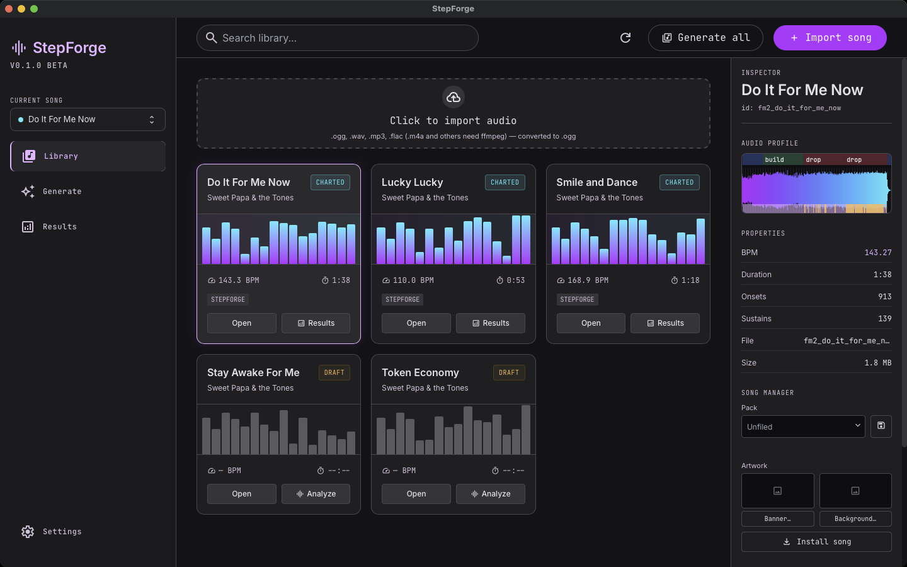
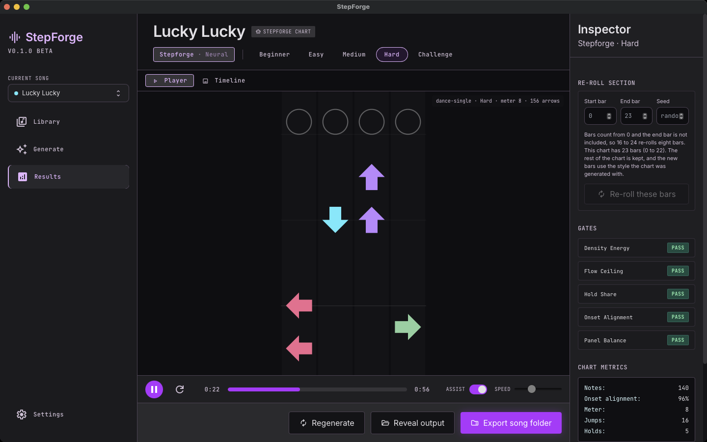

<p align="center">
  
</p>

<p align="center">
  <a href="https://github.com/Sweet-Papa-Technologies/StepForge/releases"></a>
  <a href="https://github.com/Sweet-Papa-Technologies/StepForge/actions/workflows/ci.yml"></a>
  <a href="https://discord.gg/kFHgCKr5E3"></a>
  <a href="LICENSE"></a>
</p>

# StepForge

**Turn any song into playable StepMania / ITGmania dance charts, on your own computer.**

Drop in a song, and StepForge writes Beginner through Challenge charts for it in
a few seconds, then installs them straight into ITGmania. The charting is done by
**StepForge Flow**, a small neural model that ships inside the app and runs on
your CPU: no account, no API key, no upload, no per-song cost.

> **Beta.** StepForge is new. Expect rough edges, and tell us about them on
> [Discord](https://discord.gg/kFHgCKr5E3) or in
> [Issues](https://github.com/Sweet-Papa-Technologies/StepForge/issues).

<p align="center">
  <br>
  <sub>A StepForge chart (Hard) of <em>Lucky Lucky</em> by Sweet Papa &amp; the Tones, played on autoplay in ITGmania.
  More footage: <a href="docs/media/">docs/media</a>.</sub>
</p>

## Download

Get the latest build from the **[Releases page](https://github.com/Sweet-Papa-Technologies/StepForge/releases)**.

| Platform | File | Notes |
|---|---|---|
| macOS 11+ (Apple silicon) | `StepForge-…-macos-arm64.dmg` | Signed and notarized by Apple |
| Windows 10 / 11 (x64) | `StepForge-…-windows-x64-setup.exe` | Signed |
| Linux (x64) | `StepForge-…-linux-x86_64.AppImage` or `…-amd64.deb` | |

Everything the app needs, including Python and the model, is inside the
download (about 200 MB). You also want [ITGmania](https://www.itgmania.com/)
(or StepMania 5) to play the charts.

## What it does

<p align="center">
  
</p>
<p align="center">
  
  
</p>

- **All five difficulties** from one song, with meters that rise from Beginner to Challenge.
- **Charts you can actually dance.** A foot model checks every step: no impossible
  spins, no stepping with a foot that is holding a freeze, no unforced
  double-steps, crossovers and footswitches only where the difficulty allows them.
- **On the music.** StepForge measures the song's tempo and beat grid, places steps
  on real 4th / 8th / 16th / triplet positions, and follows the song's energy:
  calm verses, busy choruses.
- **Your style.** Sliders and presets for density, streams, jumps, freezes,
  crossovers, jacks and mines, or leave them for the model to choose. Re-roll any
  section you don't like.
- **Preview before you play** in the built-in note player, then install the song
  into a pack in ITGmania with one click.
- **Imports** WAV, MP3, FLAC and OGG out of the box (other formats with
  [ffmpeg](https://ffmpeg.org/) installed).

## How good are the charts?

We charted 180 songs that have human-made charts, without showing StepForge the
human charts, and compared step by step.

| 180 held-out songs | StepForge Flow v1.4 | Best open-source auto-charter tested | Two humans |
|---|---:|---:|---:|
| Steps placed where the human charter put one (F1, ±20 ms) | **0.656** | 0.674 | ≈ 0.75 |
| … Hard / Challenge | **0.714 / 0.726** | 0.703 / 0.712 | |
| Chart statistics inside the human range | **98%** | 90% | 94% |
| Unforced double-steps | **0.01%** of steps | 1.04% | 0.35% |

StepForge is level with the best open-source tool on step placement, ahead at
Hard and Challenge, and clearly cleaner to play. Beginner and Easy are its weakest
difficulties today. Details: [model card](models/stepforge_flow/MODEL_CARD.md).

## How it works

1. **Listen.** Signal processing finds the song's tempo, beat grid and every onset.
2. **Place.** *RhythmNet* (9.6M parameters) reads the music on a musical grid of
   48 ticks per bar and decides where steps, jumps, freezes and mines go.
3. **Step.** *ChoreoNet* (15.2M parameters) chooses the arrows, thinking in terms of
   feet ("the other foot steps on its home panel") rather than arrow columns.
4. **Check.** An exact search over every possible foot position picks the final
   arrows, which is why every chart is physically playable whatever the networks say.

Both networks run with ONNX Runtime on the CPU. The architecture is described in
[`stepforge_neural_architecture_spec.md`](stepforge_neural_architecture_spec.md).

### Training data and credits

StepForge Flow v1.4 learned from 254 songs and their charts from the StepMix 1–5
community contest packs, OutFox Serenity and the StepMania 5 default songs. Every
song, its musicians and step artists, and its license are listed in
[`CREDITS.csv`](models/stepforge_flow/CREDITS.csv). Thank you to all of them.

If you made a song or chart in that list and want it left out of future models,
[open an issue](https://github.com/Sweet-Papa-Technologies/StepForge/issues) or
reach out (below) and it will be removed.

## Build from source

You need Node 22, Rust (stable) and Python 3.10+.

```bash
git clone https://github.com/Sweet-Papa-Technologies/StepForge.git
cd StepForge
python3 -m pip install -r requirements.txt     # the charting engine
cd desktop && npm ci && npm run tauri dev       # the app, against this checkout
```

Release builds bundle their own Python: `python3 desktop/scripts/stage_runtime.py`
then `npx tauri build --config src-tauri/tauri.release.conf.json`. See
[desktop/BUILD.md](desktop/BUILD.md) and [CONTRIBUTING.md](CONTRIBUTING.md).

## Community and contact

- **Discord:** https://discord.gg/kFHgCKr5E3
- **Reddit:** [u/sweetpapatech](https://www.reddit.com/user/sweetpapatech)
- **Bluesky:** [@sweetpapa.bsky.social](https://bsky.app/profile/sweetpapa.bsky.social)
- **GitHub:** [SweetPapa](https://github.com/SweetPapa)

Bug reports and ideas: [Issues](https://github.com/Sweet-Papa-Technologies/StepForge/issues).

## License

- Source code: [MIT](LICENSE).
- StepForge Flow model weights: [CC BY-NC-SA 4.0](models/stepforge_flow/LICENSE.md),
  because some of the training songs carry non-commercial and share-alike terms.
- Charts you make with StepForge are yours.

StepForge is made by [Sweet Papa Technologies](https://github.com/Sweet-Papa-Technologies).
It is not affiliated with StepMania, ITGmania, OutFox or any game publisher.
