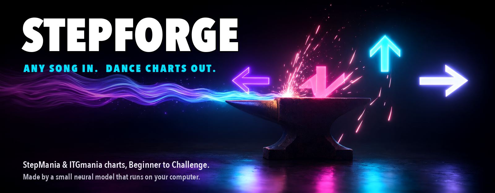
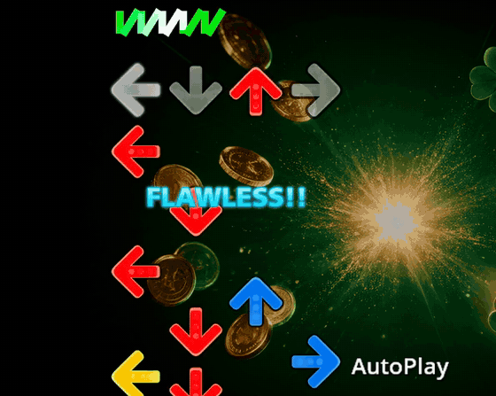
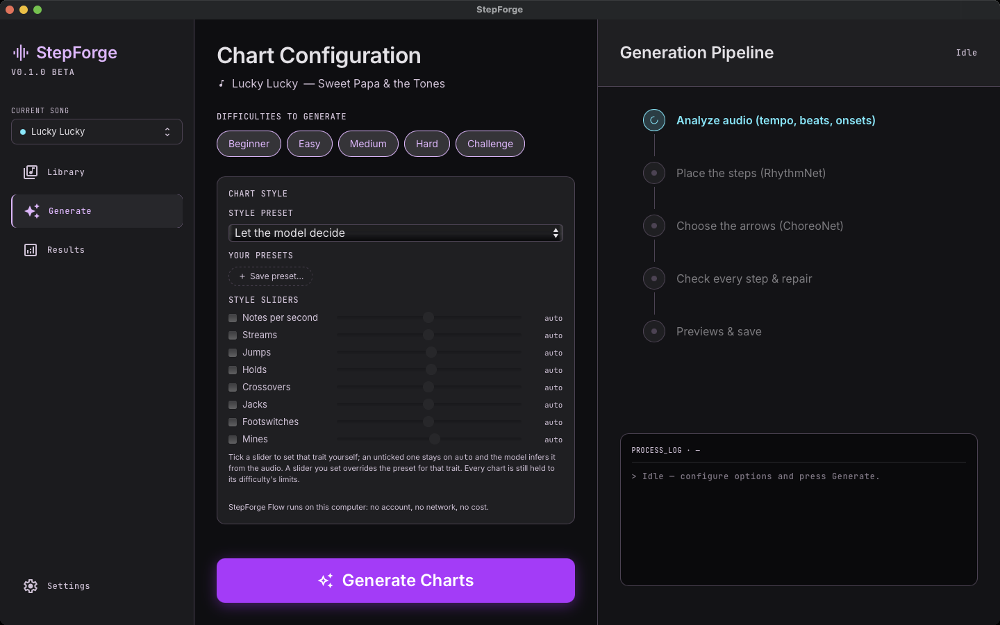

<p align="center">
  
</p>

<p align="center">
  <a href="https://github.com/Sweet-Papa-Technologies/StepForge/releases"></a>
  <a href="https://github.com/Sweet-Papa-Technologies/StepForge/actions/workflows/ci.yml"></a>
  <a href="https://step.fofo.dev"></a>
  <a href="https://discord.gg/kFHgCKr5E3"></a>
  <a href="LICENSE"></a>
</p>

# StepForge

**Turn any song into playable StepMania / ITGmania dance charts, on your own computer.**

Drop in a song, and StepForge writes Beginner through Challenge charts for it in
a few seconds, then installs them straight into ITGmania. The charting is done by
**StepForge Flow**, a small neural model that ships inside the app and runs on
your CPU: no account, no API key, no upload, no per-song cost. (The one thing
the app asks the network for is the list of StepForge releases when it starts,
so it can tell you a newer version is out. Nothing about you or your songs is
sent, and Settings has a switch to turn it off.)

> **Beta.** StepForge is new. Expect rough edges, and tell us about them on
> [Discord](https://discord.gg/kFHgCKr5E3), in
> [Issues](https://github.com/Sweet-Papa-Technologies/StepForge/issues), or
> with **Send feedback** and **Report this chart** inside the app (they open a
> prefilled issue in your browser for you to review; nothing is sent for you).

<p align="center">
  <br>
  <sub>A StepForge chart (Hard) of <em>Lucky Lucky</em> by Sweet Papa &amp; the Tones, played on autoplay in ITGmania.
  More footage: <a href="docs/media/">docs/media</a>.</sub>
</p>

## Download

Get the latest build from **[step.fofo.dev/download](https://step.fofo.dev/download)** or the
**[Releases page](https://github.com/Sweet-Papa-Technologies/StepForge/releases)**.

| Platform | File | Notes |
|---|---|---|
| macOS 12.3+ (Apple silicon: M1 and later) | `StepForge-…-macos-arm64.dmg` | Signed and notarized by Apple |
| macOS 12.3+ (Intel) | `StepForge-…-macos-x64.dmg` | Signed and notarized by Apple |
| Windows 10 / 11 (x64) | `StepForge-…-windows-x64-setup.exe` | Signed |
| Linux (x64) | `StepForge-…-linux-x86_64.AppImage` or `…-amd64.deb` | |

Everything the app needs, including Python and the model, is inside the
download (about 175 MB on Windows, 210–220 MB on macOS, 320–330 MB on Linux).
You also want [ITGmania](https://www.itgmania.com/) (or StepMania 5) to play
the charts.

## What it does

<p align="center">
  
</p>
<p align="center">
  
  
</p>

- **All five difficulties** from one song, with meters that rise from Beginner to Challenge.
- **Charts you can actually dance.** A foot model checks every step: no impossible
  spins, no stepping with a foot that is holding a freeze, no unforced
  double-steps, crossovers and footswitches only where the difficulty allows them.
- **On the music.** StepForge measures the song's tempo and beat grid, places steps
  on real 4th / 8th / 16th / triplet positions, and follows the song's energy:
  calm verses, busy choruses.
- **Tempo changes and pauses.** When a song changes tempo, or the band stops and
  comes back in, the chart follows it: the simfile gets the BPM changes and
  stops it needs, and the built-in player reads them too. Songs that hold one
  tempo (nearly all of them) are charted exactly as before.
  [How it works, and what it does not catch yet](docs/tempo-maps.md).
- **Your style.** Sliders and presets for density, streams, jumps, freezes,
  crossovers, jacks and mines, or leave them for the model to choose.
- **Your rhythm.** Cap a chart at 4ths, 8ths or 16ths, or switch on Stream mode
  for unbroken runs at one subdivision with real breaks between them.
- **Fix one part, keep the rest.** Mark a range of bars in the player and give
  it new arrows, or write it again with its own settings (subdivision, density,
  jumps, crossovers). Nothing outside the range changes.
- **Preview before you play** in the built-in note player, then install the song
  into a pack in ITGmania with one click.
- **Imports** WAV, MP3, FLAC and OGG out of the box (other formats with
  [ffmpeg](https://ffmpeg.org/) installed).

## How good are the charts?

We charted 180 songs that have human-made charts, without showing StepForge the
human charts, and compared step by step.

| 180 held-out songs | StepForge Flow v1.6 | Best open-source auto-charter tested | Two humans |
|---|---:|---:|---:|
| Steps placed where the human charter put one (F1, ±20 ms) | **0.689** | 0.674 | ≈ 0.75 |
| … Beginner | 0.606 | 0.587 | |
| … Hard / Challenge | 0.715 / 0.730 | 0.703 / 0.712 | |
| … on the 120 songs never used for tuning | 0.685 | 0.671 | |
| Notes written, relative to the human chart | 1.06× | 1.34× | |
| Chart statistics inside the human range | **97%** | 90% | 94% |
| Unforced double-steps | **none** | 1.04% of steps | 0.35% |
| Same arrow again when the music repeats, above chance (60 held-out songs) | +4.4 pts | | ≈ +4.9 |

StepForge is ahead of the best open-source tool on step placement at every
difficulty. Overall the lead (0.015) is too small for 180 songs to tell from
level; at Medium it is real. It is also clearly cleaner to play. Beginner is
still its weakest difficulty. Some decoder settings were tuned on 60 of the 180
songs; on the other 120 the picture is the same (0.685 vs 0.671).

These are the numbers for 0.1.0-beta.11 and later, which ship StepForge Flow
v1.6. Its two networks are v1.5's (0.1.0-beta.10), so step placement is the
same; what v1.6 adds is in how a chart is decoded from them:

- **Arrows come back when the music does.** Where a bar sounds like an earlier
  one, the chart leans toward the arrows it used there. Without this the same
  arrow returned 1.3 points more often than chance; now 4.4, close to what
  human charts do.
- **The footswitch slider works.** Asked for 6% footswitches, a chart shows
  6.3% as a player reads it (v1.5: 1.7%).
- **Faster streams.** Stream mode writes 16th-note streams up to 200 BPM at
  Challenge and 170 BPM at Hard (v1.5: 150 and 120).

Betas before 10 shipped v1.4, which scored 0.671 at its best (0.562 at
Beginner); the gain is larger than chance on these songs. v1.5 and v1.6 are
trained on the same songs as v1.4. What changed is how: the rhythm network
learned to tell which half of the beat the grid sits on, and the step network
learned to follow the crossover and jack sliders, which did nothing measurable
before. Details: [model card](models/stepforge_flow/MODEL_CARD.md).

We also checked for memorization. StepForge doesn't reproduce its training
charts (its longest exact copy of one is 8 steps), and it carries fewer
training patterns into new songs than human step artists do. It does place
steps a little better on the songs it trained on than on new ones, mostly at
Beginner and Easy. See the
[model card](models/stepforge_flow/MODEL_CARD.md#memorization-check).

## How it works

1. **Listen.** Signal processing finds the song's tempo, beat grid and every onset,
   and checks that the one tempo holds from the first bar to the last. Where it
   does not (a tempo change, a pause, a bar cut short), the grid is re-seated
   there and the simfile carries the change.
2. **Place.** *RhythmNet* (9.6M parameters) reads the music on a musical grid of
   48 ticks per bar and decides where steps, jumps, freezes and mines go.
3. **Step.** *ChoreoNet* (15.2M parameters) chooses the arrows, thinking in terms of
   feet ("the other foot steps on its home panel") rather than arrow columns.
4. **Check.** An exact search over every possible foot position picks the final
   arrows, which is why every chart is physically playable whatever the networks say.

Both networks run with ONNX Runtime on the CPU. The
[model card](models/stepforge_flow/MODEL_CARD.md) describes what was built; the
original design plan is in
[`docs/stepforge_neural_architecture_spec.md`](docs/stepforge_neural_architecture_spec.md).

### Training data and credits

StepForge Flow v1.6 learned from 254 songs and their charts from the StepMix 1–5
community contest packs, OutFox Serenity and the StepMania 5 default songs. Every
song, its musicians and step artists, and its license are listed in
[`CREDITS.csv`](models/stepforge_flow/CREDITS.csv). Thank you to all of them.

If you made a song or chart in that list and want it left out of future models,
[open an issue](https://github.com/Sweet-Papa-Technologies/StepForge/issues) or
reach out (below) and it will be removed.

## Build from source

You need Node 22, Rust (stable) and Python 3.10+.

```bash
git clone https://github.com/Sweet-Papa-Technologies/StepForge.git
cd StepForge
python3 -m pip install -r requirements.txt     # the charting engine
cd desktop && npm ci && npm run tauri dev       # the app, against this checkout
```

Release builds bundle their own Python: `python3 desktop/scripts/stage_runtime.py`
then `npx tauri build --config src-tauri/tauri.release.conf.json`. See
[desktop/BUILD.md](desktop/BUILD.md) and [CONTRIBUTING.md](CONTRIBUTING.md).

## Community and contact

- **Website and news:** https://step.fofo.dev
- **Discord:** https://discord.gg/kFHgCKr5E3
- **Reddit:** [u/sweetpapatech](https://www.reddit.com/user/sweetpapatech)
- **Bluesky:** [@sweetpapa.bsky.social](https://bsky.app/profile/sweetpapa.bsky.social)
- **GitHub:** [SweetPapa](https://github.com/SweetPapa)

Bug reports and ideas: [Issues](https://github.com/Sweet-Papa-Technologies/StepForge/issues).

## License

- Source code: [MIT](LICENSE).
- StepForge Flow model weights: [CC BY-NC-SA 4.0](models/stepforge_flow/LICENSE.md),
  because some of the training songs carry non-commercial and share-alike terms.
- Charts you make with StepForge are yours. Every chart it writes is credited
  **StepForge (AI-generated)**; if you share charts made with it, please keep
  that credit or say they were made with StepForge.

StepForge is made by [Sweet Papa Technologies](https://github.com/Sweet-Papa-Technologies).
It is not affiliated with StepMania, ITGmania, OutFox or any game publisher.
